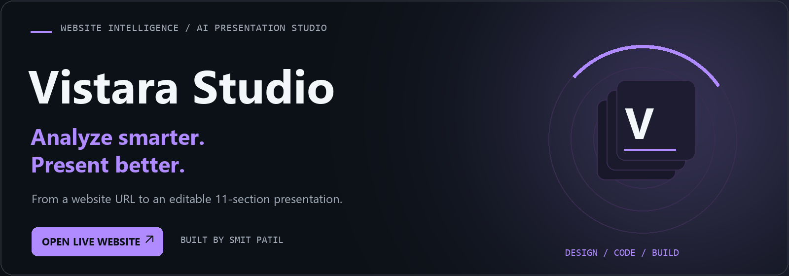
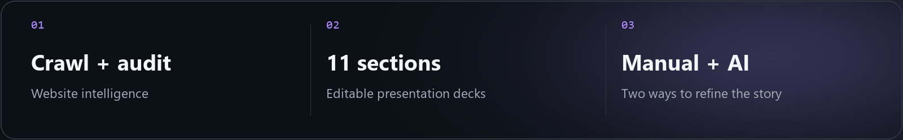

<a href="https://vistara-studio-smitpatil1959-1013s-projects.vercel.app/">

</a>

<div align="center">

**[OPEN LIVE WEBSITE](https://vistara-studio-smitpatil1959-1013s-projects.vercel.app/)** &nbsp; / &nbsp; **[RUN LOCALLY](#run-locally)** &nbsp; / &nbsp; **[MEET THE DEVELOPER](https://smit-patil-portfolio-eight.vercel.app/)**

</div>

# Vistara Studio

**Website intelligence, presented.**

Vistara reads a live website end to end, combines crawling with a five-axis audit and an AI creative brief, then composes an 11-section presentation. Edit it manually or through natural-language commands, present it, and export or share the result.



## From URL to presentation

| Stage | What happens |
| --- | --- |
| **Explore** | Submit a public website URL and collect website evidence through crawling |
| **Understand** | Review analysis, a five-axis audit and an AI-assisted creative brief |
| **Create** | Generate an 11-section presentation from the study |
| **Refine** | Edit slides directly or request changes in natural language |
| **Present** | Open the fullscreen presentation and export or share the result |

## Stack

| Layer | Technologies |
| --- | --- |
| Interface | React 19, TypeScript in strict mode, Tailwind CSS 4 |
| Motion and icons | Framer Motion, Lucide React |
| Tooling | Vite 7, ESLint |
| Data and identity | Supabase, PostgreSQL |
| API and hosting | Vercel serverless functions |
| Rendered crawling | Playwright Core, serverless Chromium |
| Deck export | PptxGenJS |

## Run locally

Use Node.js compatible with Vite 7; Node 22.12 or later is a suitable baseline.

```sh
git clone https://github.com/smitpatil1959-design/Vistara-Studio.git
cd Vistara-Studio
npm ci
```

Create `.env.local` using [ENV_SETUP.md](./ENV_SETUP.md) and the committed [.env.example](./.env.example). Configure the same Supabase project for server access and browser authentication, and initialize the database using the schema and configuration guidance.

```sh
npm run dev
```

The Vite configuration includes local backend API middleware. Optional OpenAI-backed research requires your own provider key; basic crawling and analysis remain available without it, as described in the environment guide.

## Environment

Set `SUPABASE_URL` and `SUPABASE_SERVICE_ROLE_KEY` for the server, plus `VITE_SUPABASE_URL` and `VITE_SUPABASE_ANON_KEY` for browser auth. Use the same Supabase project for both. Google OAuth credentials are configured in Supabase Dashboard, not in `.env`. See [ENV_SETUP.md](./ENV_SETUP.md).

## Validation and scripts

| Command | Purpose |
| --- | --- |
| `npm run dev` | Start Vite with local backend API middleware |
| `npm run build` | Run the prebuild specification step, TypeScript build and Vite production build |
| `npm run lint` | Run ESLint |
| `npm test` | Run the configured regression and backend/database/workflow suites |
| `npm run test:backend` | Run focused backend, database and workflow tests |
| `npm run test:v2` | Run the v2 suite |
| `npm run audit:backend` | Run the backend audit script |
| `npm run test:e2e` | Run the configured end-to-end runner |
| `npm run preview` | Preview the built frontend |

<details>
<summary><strong>Engineering details: architecture, routes and crawler boundaries</strong></summary>

## Architecture

| Location | Responsibility |
| --- | --- |
| `src/app/` | Router and route map |
| `src/pages/` | Landing, authentication, dashboard, create, settings, studio and presentation routes |
| `src/components/ui/` | Spinner, ScoreRing, Pill, EditableText, EmptyState and SectionHead primitives |
| `src/components/layout/` | Logo, Ambient and TopNav |
| `src/components/deck/` | SlideRenderer and supporting deck elements |
| `UrlStudyForm` | Shared URL intake across landing, dashboard and create |
| `src/studio/` | CrawlStage, AnalysisView, AuditView, UnderstandView and EditorStage |
| `src/landing/` | Marketing sections and showcase |
| `src/services/` | Typed API clients for HTTP, projects, slides, chat and AI; UI does not call `/api` directly |
| `src/hooks/` | Session, project, study creation, chat and toast hooks |
| `src/lib/` | Supabase client, preferences, formatters and deck theme tokens |
| `src/types/` | Canonical domain models that mirror the database schema |
| `api/` | Vercel routes for projects, analysis, generation, slides, chat and AI |
| `server/` | Crawler, audit, understanding, deck generation and natural-language commands |
| `supabase/schema.sql` | Database tables, constraints and indexes |

## Routes

| Route | Purpose |
| --- | --- |
| `/` | Marketing surface with live interactive demos |
| `/login` `/signup` | Email + Google auth (Supabase); guest mode preserved |
| `/dashboard` | Workspace — list / create / delete studies |
| `/create` | Dedicated new-study intake |
| `/settings` | Account, default theme for new studies, data notes |
| `/project/:id` | Project workspace (crawl → report → editor) |
| `/project/:id/audit` | Workspace opened on the audit report |
| `/project/:id/presentation` | Workspace opened in the deck studio |
| `/present/:id` · `/p/:id` | Fullscreen present mode + PDF print sheet |

## Crawler security boundary

`server/security.js` treats every submitted URL as untrusted: http/https only,
ports 80/443 only, no embedded credentials, no localhost / private / loopback /
link-local / CGNAT / multicast / metadata targets — enforced by DNS resolution
on every validated host and on every redirect hop (walked manually). The
rendered capture (`server/browserCrawl.js`, Playwright on serverless Chromium)
additionally firewalls *every* request the page makes through a per-host cached
verdict, blocks `media` weight, and caps pages / navigation time / total budget /
HTML bytes / screenshot bytes / captured console errors and failed requests.
Document-level fallback capture reuses the same validation. Scan output stores
summaries only — HTML bodies and raw screenshots never touch the database
(screenshots go to the public `screenshots` storage bucket).

Status lifecycle: `queued → crawling → processing → completed | failed`
(+ `generating → generated` for deck composition).


</details>

---

<p align="center">
Built by <a href="https://github.com/smitpatil1959-design"><strong>Smit Patil</strong></a><br />
Frontend Development Specialist &amp; AI / Software Developer<br /><br />
<a href="https://smit-patil-portfolio-eight.vercel.app/">Portfolio</a> &nbsp; / &nbsp;
<a href="https://www.linkedin.com/in/smitpatil2008/">LinkedIn</a>
</p>
