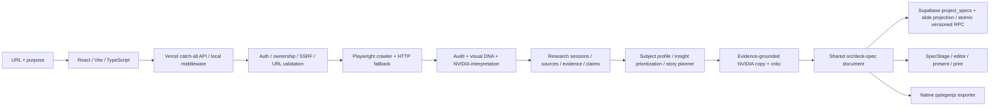

# Vistara Studio V2 architecture and implementation plan

## Existing architecture (inspected before implementation)

The existing system already has security checks, research-run isolation, stable project relationships, transactional document persistence, asset permissions and a shared browser/server slide format. These stay in place.

| Responsibility | Existing implementation | V2 work |
| --- | --- | --- |
| Routes and projects | `src/pages/Studio.tsx`, `Present.tsx`, `CreatePage.tsx`; `src/services` | Retain routes and API contracts; make the editor a dedicated workspace. |
| Document | `src/deck-spec/types.ts`, `validate.ts`, `ops.ts`, `fromSlides.ts` | Add migration, Brand Kit, source/asset references, notes, richer elements and transforms. Compile the same source to `server/spec`. |
| Editor | `EditorStage`, `InteractiveCanvas`, `SlideRail`, `InspectorPanel` | Replace limited single-selection shell with real tool panels, multi-selection/transforms, guides, zoom, drag ordering and contextual properties. |
| Research | `engine.js`, `browserCrawl.js`, `webSearch.js`, `researchOrchestrator.js`, `evidenceExtraction.js`, `claimEngine.js` | Preserve evidence flow, URL protections, limits and source traceability. |
| Brand intelligence | Live computed style samples, `extractVisualDna`, `dnaEngine.js` | Prioritize labelled CSS tokens, visible CTAs/navigation and logos; persist confidence/provenance and distinguish fallbacks. |
| Story and design | `server/presentation/*`, `presentationPlanner.js` | Keep purpose-aware story; add reusable, shared compositions and coordinated brand rhythm after content validation. |
| AI editing | Immediate rule-based `server/api/ai.js` and `aiDirector.js` | Add a reviewable structured proposal mode grounded in the selected slide and current evidence; apply locally through undo/history and versioned save. Preserve legacy commands. |
| Persistence | `DocumentSaver`, `project_specs`, `save_project_deck` RPC | Retain serial saving and expected-version rejection; do not erase existing data. JSONB accommodates additive document features. |
| Export | `server/export/pptx.js`, `elements.js`, readiness/image checks | Use shared absolute geometry; support transforms, notes, tables, diagrams, chart types, image fit and sources. |
| Hosting | Vite build, three Vercel API functions, Supabase | Retain Vercel Hobby architecture; no paid service or new hosting platform. |

## Identified gaps

- The editor hides most tools on smaller screens and lacks multi-select, grouping, locking, zoom, pan, rotation, snapping, copy/paste and drag ordering.
- Renderer properties cover fewer settings than the document style can store. Protected relative image URLs are rejected by the image renderer.
- Charts insert arbitrary example values and only render bars. No native editable table/diagram model exists.
- Four flow layouts and one global appearance make generated decks repetitive. Browser flow geometry and PPTX flow geometry differ.
- Brand samples lack weighted provenance; black/white can become an accidental primary. Brand detection is not a reusable user-editable kit.
- AI edits execute immediately and reset undo history, creating a risk to manual work.
- Old document normalization drops some fields; recursive duplication does not renew nested IDs.

## Target design

An original neutral Vistara workspace with its existing lime identity: compact document toolbar, narrow tool dock, searchable content panel, prominent canvas, contextual inspector, and bottom slide strip/status/zoom controls. The researched brand styles the slides rather than the editor chrome. Tablet panels collapse; mobile supports preview and essential editing.

Interaction references (patterns, not visual copies): [Canva grouping/layers](https://www.canva.com/help/layer-group-align/?query=group), [Gamma themes](https://help.gamma.app/en/articles/11029150-how-do-i-customize-themes-colors-and-fonts-in-gamma), [Wix inspector](https://support.wix.com/en/article/studio-editor-using-the-inspector-panel).

## Delivery stages

1. Foundation: preserve working protections; extend/migrate the shared document and add regression tests.
2. Brand: collect weighted signals and generate a provenance-backed Brand Kit with accessible palettes.
3. Design: shared composition catalogue, deterministic layout/contrast checks and varied brand-aware generated decks.
4. Editor: working tool dock/panels, navigator, transforms, contextual inspector, history and persistence.
5. AI: preview structured proposals; protect concurrent manual changes; apply through undoable document edits.
6. Export: native editable output using the same essential geometry and content.
7. Acceptance: multiple real websites and purposes; real editor actions, refresh, permissions and export; actual rendered screenshots and final report.

Each stage gets targeted validation before dependent integration. Existing uncommitted backend reliability fixes are retained. No project data is deleted and no production deployment is assumed.
